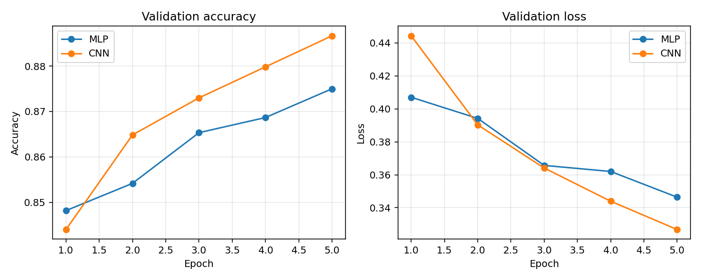

# TP5 report

Both assignment architectures were trained for five epochs, batch size 64,
Adam, sparse categorical cross-entropy. Fashion-MNIST provides 60,000 training
and 10,000 test images. A 10% validation partition is taken from the training
set; the test set is evaluated only after training. Pixels are divided by 255.

| Model | Test accuracy | Loss | Parameters | H5 MB | Inference FLOPs* | Training step FLOPs* (batch 64) | Training memory MB* |
|---|---|---|---|---|---|---|---|
| MLP | 0.8693 | 0.3745 | 235146 | 0.916 | 469504 | 90144768 | 4.163 |
| CNN | 0.8807 | 0.3452 | 56714 | 0.245 | 1413504 | 271392768 | 10.175 |

*FLOPs and training memory are analytical estimates, not hardware measurements.
One multiply-add counts as two FLOPs. Forward FLOPs include Dense and Conv2D
kernels; activations, bias, pooling, and softmax are excluded. A training step
means **one batch of 64**, approximated as three forward-pass costs per sample.
Training memory estimates parameters, gradients, two Adam moments (16 bytes
per parameter), plus approximate batch activation/gradient storage. TensorFlow
runtime, data storage, workspaces, and allocator overhead are excluded, so this
is not a measured peak. Model-file MB means bytes / 1024².

**CNN** achieved higher test accuracy in this run; **CNN** has fewer
parameters. CNN filters share weights across image locations and preserve
spatial structure, helping learn local patterns. The MLP is simple and uses
fewer arithmetic operations here, but its first dense layer connects every
pixel to every hidden neuron. Fewer parameters do not necessarily mean fewer
FLOPs: convolutions reuse kernels at many locations.

Saved .keras files are the reusable models for TP6; .h5 files satisfy the size
comparison. Measurements are from this computer; Colab runs may differ.

Source: https://github.com/ahmed3991/AIoT-2025/blob/main/TP5/TP5.md
